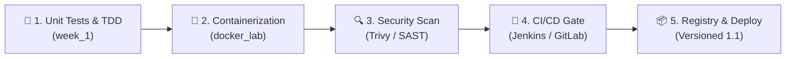

# 🛡️ DevSecOps Labs — Master Portfolio

Hands-on engineering laboratories completed for the **DevSecOps (Semester 5)** curriculum. This repository encompasses shift-left security practices across the entire software development lifecycle—ranging from test-driven development (TDD) quality gates, secure containerization, and vulnerability scanning, to continuous integration workflows.

---

## 📚 Laboratories & Modules Overview

| Module Directory | Topic & Scope | Technologies | Key Highlights & Deliverables |
|:---|:---|:---|:---|
| [**`week_1/`**](week_1/) | **Test-Driven Development (TDD) & Unit Testing** | Python 3.13 (`pytest`), Java 25 (`JUnit 5`), Maven | 121 automated unit tests across 6 core exercises covering edge cases, overflow safeguards, null safety, and data transformation with a 100% pass rate. |
| [**`docker_lab/`**](docker_lab/) | **From First Container to Secure Production Image** | Docker, Trivy, GitLab Container Registry | Container lifecycle, layer caching optimization, unprivileged `appuser` hardening (remediating DS-0002), vulnerability scanning, and versioned registry publishing (`1.1`). |
| [**`git_lab_devsecops/`**](git_lab_devsecops/) | **GitLab DevSecOps Workflows & Branching** | Git, GitLab, Branch Protection | Automated workflow practices, branch protection policies, and DevSecOps collaboration frameworks. |
| [**`jenkins_lab/`**](jenkins_lab/) | **Continuous Integration Automation** | Jenkins, CI/CD Pipelines | Automated build and test pipeline orchestration, quality gate enforcement, and artifact tracking. |

---

## 🎯 DevSecOps Philosophy: The Shift-Left Pipeline

1. **Shift-Left Quality (TDD)**: Catching logic errors and boundary defects before code reaches packaging ([`week_1`](week_1/)).
2. **Container Security**: Hardening base images, eliminating root execution, reducing attack surface ([`docker_lab`](docker_lab/)).
3. **Automated Scanning**: Continuous vulnerability scanning with Trivy.
4. **CI/CD Pipeline Gates**: Automated test and scan verification before build artifacts can be pushed or deployed.

---

## 👤 Author

- **Abdelbari Refak** ([@abdelbarirefak](https://github.com/abdelbarirefak))
- DevSecOps Engineering — S5
