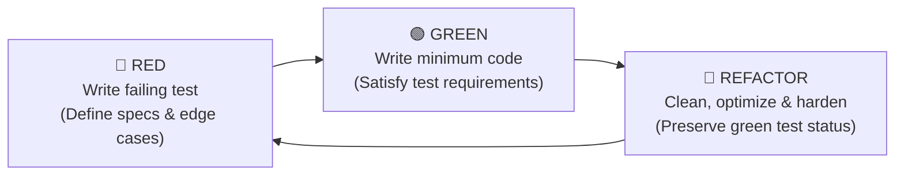

# 🧪 DevSecOps Lab 1: Test-Driven Development (TDD) & Automated Unit Testing

[](python/)
[](python/)
[](java/)
[](java/)
[-success?style=for-the-badge)](.)
[-6f42c1?style=for-the-badge)](.)
[](..)

---

## 📌 Executive Summary & DevSecOps Context

In modern **DevSecOps**, software security and reliability begin long before containerization, infrastructure provisioning, or deployment. The **"Shift-Left"** philosophy asserts that catching defects, unhandled boundary conditions, and type safety issues during development is orders of magnitude faster, cheaper, and safer than discovering them in production or staging environments.

**Test-Driven Development (TDD)** serves as the foundational **first quality gate** in any automated Continuous Integration (CI) pipeline. By writing rigorous, exhaustive test suites *before* crafting application logic, developers define rigid contracts that code must satisfy. When hooked into automated CI runners (such as GitLab CI or Jenkins), these tests act as an unyielding filter—blocking regressions, invalid data handling, and silent exceptions from entering downstream build and container packaging phases.

This repository module contains a dual-language (**Java 17+/25** and **Python 3.13**) implementation of **6 core engineering exercises**, strictly developed following the TDD methodology with **121 automated unit tests** achieving a **100% pass rate**.

---

## 🔄 The TDD Lifecycle: Red — Green — Refactor

Every component across both Java and Python was architected adhering to the three phases of Test-Driven Development:



1. **🔴 Red Phase**: Write comprehensive test assertions specifying normal workflows, boundary limits, negative values, and invalid input types. Tests initially fail or fail to compile, formally proving the requirement is not yet fulfilled.
2. **🟢 Green Phase**: Write the simplest, cleanest implementation code that allows all test assertions to pass successfully.
3. **🔵 Refactor Phase**: Eliminate duplication, optimize algorithmic complexity (e.g., $O(n)$ traversals, dictionary lookups), add complete docstrings, and harden types and exception handling while guaranteeing the test suite stays green.

---

## 📊 Comprehensive Exercise Catalog & Test Matrix

A total of **121 automated tests** (62 in Python with Pytest, 59 in Java with JUnit 5 Jupiter) exhaustively validate logic across all domains:

| # | Exercise Domain | Java Implementation | Java Test Suite (JUnit 5) | Python Implementation | Python Test Suite (Pytest) | Tests (Py / Java) | Primary Edge Cases & Defensive Safeguards |
|:---:|:---|:---|:---|:---|:---|:---:|:---|
| **1** | **Arithmetic Operations** | [`ArithmeticOperations.java`](java/ArithmeticOperations.java) | [`ArithmeticOperationsTest.java`](java/ArithmeticOperationsTest.java) | [`arithmetic_operations.py`](python/arithmetic_operations.py) | [`test_arithmetic_operations.py`](python/test_arithmetic_operations.py) | **11 / 11** | Zero division trapping, 64-bit integer overflow protection (`long` in Java), negative sign parity |
| **2** | **String Manipulation** | [`StringManipulator.java`](java/StringManipulator.java) | [`StringManipulatorTest.java`](java/StringManipulatorTest.java) | [`string_manipulator.py`](python/string_manipulator.py) | [`test_string_manipulator.py`](python/test_string_manipulator.py) | **10 / 9** | Null / `None` pointer validation, empty strings, Unicode characters, whitespace preservation, palindromes |
| **3** | **Array / List Operations** | [`ArrayOperations.java`](java/ArrayOperations.java) | [`ArrayOperationsTest.java`](java/ArrayOperationsTest.java) | [`array_operations.py`](python/array_operations.py) | [`test_array_operations.py`](python/test_array_operations.py) | **9 / 8** | Empty list exceptions (`NoSuchElementException` / `ValueError`), negative-only arrays, single element, type guards |
| **4** | **Input & Email Validation** | [`EmailValidator.java`](java/EmailValidator.java) | [`EmailValidatorTest.java`](java/EmailValidatorTest.java) | [`email_validator.py`](python/email_validator.py) | [`test_email_validator.py`](python/test_email_validator.py) | **13 / 15** | RFC compliance, double `@`, missing local/domain/TLD parts, whitespace containment, subdomain support |
| **5** | **Exception Handling** | [`Divider.java`](java/Divider.java) | [`DividerTest.java`](java/DividerTest.java) | [`divider.py`](python/divider.py) | [`test_divider.py`](python/test_divider.py) | **9 / 9** | `ArithmeticException` vs `ZeroDivisionError`, zero dividend vs divisor, precision fractions, negative operands |
| **6** | **Data Transformation (CSV)**| [`CsvConverter.java`](java/CsvConverter.java) | [`CsvConverterTest.java`](java/CsvConverterTest.java) | [`csv_converter.py`](python/csv_converter.py) | [`test_csv_converter.py`](python/test_csv_converter.py) | **8 / 7** | Dynamic schema aggregation (union of keys), missing key blank padding, non-dict/null record skipping, type safety |
| | **Totals** | | | | | **62 / 59 (121)** | **100% Pass Rate across all suites** |

---

## 🔍 Detailed Exercise Breakdown

### 1. Basic Arithmetic Operations
- **Objective**: Implement robust multiplication and division operations supporting standard math, edge boundaries, and explicit zero handling.
- **Defensive Safeguards**:
  - **Integer Overflow**: Java's `multiply(int a, int b)` casts operands to `long` before computation, preventing silent 32-bit arithmetic wrapping when dealing with large numbers (e.g. $100{,}000 \times 100{,}000$).
  - **Zero Division**: Explicitly verifies that division by zero throws an `IllegalArgumentException` / `ZeroDivisionError`.
  - **Sign Rules**: Verified against positive $\times$ negative, negative $\times$ negative, and negative dividends/divisors.

### 2. String Manipulation (Reversal)
- **Objective**: Reverse arbitrary character sequences efficiently while strictly validating inputs.
- **Defensive Safeguards**:
  - **Null Safety**: Protects against Null Pointer Exceptions (NPE) by throwing `IllegalArgumentException` (Java) or `TypeError` (Python) with clear diagnostic messaging.
  - **Whitespace Integrity**: Retains leading, trailing, and internal whitespace without truncation or alteration.
  - **Character Encoding**: Correctly handles ASCII, punctuation, and Unicode symbols.

### 3. Array / List Maximum Finder
- **Objective**: Traverse collections to locate the maximum numerical value in $O(n)$ time and $O(1)$ auxiliary space.
- **Defensive Safeguards**:
  - **Empty Collection Guard**: An empty input collection throws `NoSuchElementException` (Java) or `ValueError` (Python), preventing undefined index lookups.
  - **Negative Bounds**: Initialization sets the baseline to the first element ($arr[0]$) rather than zero ($0$), ensuring arrays containing solely negative values (e.g., `[-50, -10, -5]`) correctly return `-5`.

### 4. User Input & Email Validator
- **Objective**: Validate user-supplied email strings against structural standards using regular expressions and strict boundary checks.
- **Defensive Safeguards**:
  - **Regex Structure**: Requires valid local-part (`[a-zA-Z0-9._%+-]+`), `@` symbol, valid domain names with optional subdomains, and a minimum 2-character Top-Level Domain (TLD).
  - **Attack & Error Vectors Covered**: Multiple `@` signs, missing domain, missing local part, missing dot in domain, standalone `@`, empty strings, embedded spaces, and `null`/`None` values.

### 5. Exception Handling & Controlled Division
- **Objective**: Demonstrate proper exception throwing, interception, and message verification when encountering illegal arithmetic states.
- **Defensive Safeguards**:
  - **Explicit Exception Types**: Throws `ArithmeticException` with descriptive message `"Division by zero is not allowed"` in Java, and `ZeroDivisionError` in Python.
  - **Zero Dividend**: Confirms that $0 / x = 0.0$ does not falsely trigger zero-division exception logic.

### 6. Data Transformation: Dictionaries to CSV
- **Objective**: Transform heterogeneous records (lists of key-value maps / dictionaries) into a standardized CSV string.
- **Defensive Safeguards**:
  - **Dynamic Schema Union**: Records with differing keys are consolidated. The header reflects the ordered union of all unique keys across all records.
  - **Missing Value Handling**: If a record lacks a key present in another record, its column is gracefully padded with an empty string rather than crashing with a `KeyError`.
  - **Malformed Records**: Non-dictionary or null elements in the list are gracefully filtered out without halting serialization.

---

## 🚀 How to Run the Tests

### Option A: Python Suite (Pytest)

The Python test suite uses `pytest` and requires Python 3.10+ (tested on Python 3.13).

```bash
# Navigate to the Python test directory
cd week_1/python

# (Optional) Create and activate a virtual environment
python -m venv .venv
# Windows:
.venv\Scripts\activate
# Linux/macOS:
# source .venv/bin/activate

# Install pytest if not already installed
pip install pytest

# Execute all 62 unit tests with verbose output
python -m pytest -v
```

#### Sample Test Output:
```text
============================= test session starts =============================
platform win32 -- Python 3.13.7, pytest-9.0.3, pluggy-1.6.0
rootdir: C:\Users\Admin\DevSecOps_labs\week_1\python
collected 62 items

test_arithmetic_operations.py::test_multiply_positives PASSED            [  1%]
test_arithmetic_operations.py::test_multiply_negative PASSED             [  3%]
...
test_csv_converter.py::test_missing_keys PASSED                          [ 38%]
test_divider.py::test_divide_by_zero PASSED                              [ 58%]
test_email_validator.py::test_valid_standard PASSED                      [ 61%]
test_string_manipulator.py::test_reverse_normal_string PASSED            [ 85%]
test_string_manipulator.py::test_reverse_non_string_input PASSED         [100%]

============================= 62 passed in 0.14s ==============================
```

---

### Option B: Java Suite (JUnit 5 / Maven)

The Java suite uses **JUnit 5 Jupiter** and can be run via Apache Maven or directly compiled using `javac`.

#### Using Maven (Recommended):
```bash
# Navigate to the Java project directory
cd week_1/java

# Execute clean and run all 59 unit tests
mvn clean test
```

#### Sample Maven Output:
```text
[INFO] Scanning for projects...
[INFO] -------------------< com.devsecops:week1-unit-tests >-------------------
[INFO] Building DevSecOps Week 1 - Unit Tests (JUnit 5) 1.0.0
[INFO] --------------------------------[ jar ]---------------------------------
[INFO] Compiling 6 source files with javac [debug release 17] to target\classes
[INFO] Compiling 12 source files with javac [debug release 17] to target\test-classes
[INFO] 
[INFO] -------------------------------------------------------
[INFO]  T E S T S
[INFO] -------------------------------------------------------
[INFO] Running ArithmeticOperationsTest
[INFO] Tests run: 11, Failures: 0, Errors: 0, Skipped: 0, Time elapsed: 0.069 s
[INFO] Running ArrayOperationsTest
[INFO] Tests run: 8, Failures: 0, Errors: 0, Skipped: 0, Time elapsed: 0.032 s
[INFO] Running CsvConverterTest
[INFO] Tests run: 7, Failures: 0, Errors: 0, Skipped: 0, Time elapsed: 0.028 s
[INFO] Running DividerTest
[INFO] Tests run: 9, Failures: 0, Errors: 0, Skipped: 0, Time elapsed: 0.022 s
[INFO] Running EmailValidatorTest
[INFO] Tests run: 15, Failures: 0, Errors: 0, Skipped: 0, Time elapsed: 0.029 s
[INFO] Running StringManipulatorTest
[INFO] Tests run: 9, Failures: 0, Errors: 0, Skipped: 0, Time elapsed: 0.022 s
[INFO] 
[INFO] Results:
[INFO] Tests run: 59, Failures: 0, Errors: 0, Skipped: 0
[INFO] ------------------------------------------------------------------------
[INFO] BUILD SUCCESS
[INFO] ------------------------------------------------------------------------
```

---

## 📁 Repository Structure

```text
week_1/
├── .gitignore                          # Clean ignore rules (pycache, pytest, target, class files)
├── README.md                           # Comprehensive documentation & test report
├── Week 1 Unit Test tutorial.pdf       # Original course tutorial & assignment handout
├── tutorial_analysis.md                # Breakdown of tutorial specifications & requirements
├── complete_codebase_summary.md        # Codebase test coverage summary
├── java/                               # Java 17+ / JUnit 5 implementation
│   ├── pom.xml                         # Maven build & Surefire test runner configuration
│   ├── ArithmeticOperations.java       # Ex 1: Multiplication & division logic
│   ├── ArithmeticOperationsTest.java   # Ex 1: 11 JUnit 5 test cases
│   ├── ArrayOperations.java            # Ex 3: Array maximum element search
│   ├── ArrayOperationsTest.java        # Ex 3: 8 JUnit 5 test cases
│   ├── CsvConverter.java               # Ex 6: List of Maps to CSV transformer
│   ├── CsvConverterTest.java           # Ex 6: 7 JUnit 5 test cases
│   ├── Divider.java                    # Ex 5: Defensive division with exceptions
│   ├── DividerTest.java                # Ex 5: 9 JUnit 5 test cases
│   ├── EmailValidator.java             # Ex 4: RFC regex email validator
│   ├── EmailValidatorTest.java         # Ex 4: 15 JUnit 5 test cases
│   ├── StringManipulator.java          # Ex 2: Safe string reversal algorithm
│   └── StringManipulatorTest.java      # Ex 2: 9 JUnit 5 test cases
└── python/                             # Python 3.13 / Pytest implementation
    ├── arithmetic_operations.py        # Ex 1: Arithmetic functions
    ├── test_arithmetic_operations.py   # Ex 1: 11 Pytest unit tests
    ├── array_operations.py             # Ex 3: List max element function
    ├── test_array_operations.py        # Ex 3: 9 Pytest unit tests
    ├── csv_converter.py                # Ex 6: Dicts-to-CSV transformation
    ├── test_csv_converter.py           # Ex 6: 8 Pytest unit tests
    ├── divider.py                      # Ex 5: Division with ZeroDivisionError
    ├── test_divider.py                 # Ex 5: 9 Pytest unit tests
    ├── email_validator.py              # Ex 4: Regex email validator
    ├── test_email_validator.py         # Ex 4: 13 Pytest unit tests
    ├── string_manipulator.py           # Ex 2: Reversal with type/boundary guards
    └── test_string_manipulator.py      # Ex 2: 10 Pytest unit tests
```

---

## 🛡️ DevSecOps Pipeline Integration

In an automated CI/CD pipeline (e.g. GitLab CI, Jenkins, GitHub Actions), this test suite forms the **Unit Test Quality Gate**:

```yaml
# Example GitLab CI Stage:
stages:
  - test
  - security-scan
  - build-docker

unit-test-python:
  stage: test
  image: python:3.13-slim
  script:
    - pip install pytest
    - cd week_1/python
    - python -m pytest -v

unit-test-java:
  stage: test
  image: maven:3.9-eclipse-temurin-17
  script:
    - cd week_1/java
    - mvn test
```

If any single unit test fails, pipeline execution halts immediately, preventing insecure, erroneous, or unstable artifacts from reaching downstream build, containerization, or deployment stages.
